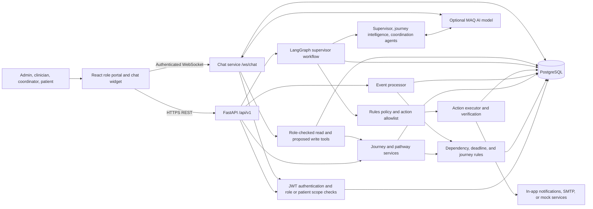
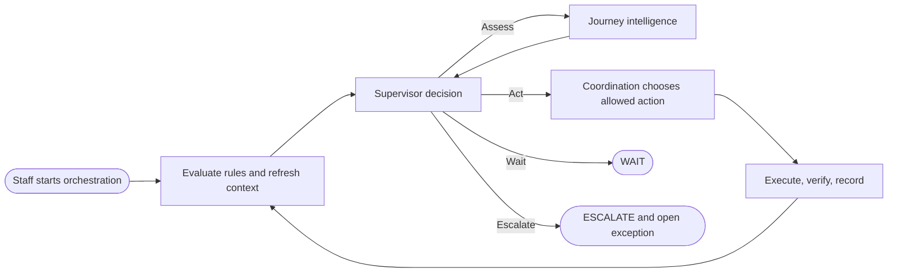

# Patient Journey Orchestrator (CarePath)

## Two-line description

CarePath manages patient care pathways, journey steps, events, exceptions, and staff or patient follow-up in role-specific portals.
Deterministic rules and verified actions control journey state; three optional AI agents assist with assessment and operational follow-up.

## Project at a glance

| Area | Implemented in this repository |
| --- | --- |
| Frontend | React 19 and Vite 7 portals for administrators, clinicians, care coordinators, and patients; dashboard, journey views, pathway and user management, and chat widget. |
| Backend | FastAPI REST API under `/api/v1`, authenticated chat WebSocket at `/ws/chat`, SQLAlchemy models, authorization, business services, rules, and orchestration. |
| Database | PostgreSQL is the source of truth for accounts, patients, pathway templates, journeys, steps, events, actions, exceptions, notifications, agent runs, and chat history/audit. |
| AI | Optional OpenAI-compatible MAQ AI client for a three-agent LangGraph workflow and a separate tool-using CarePath chat assistant. The orchestration graph has a rules-only fallback when AI is unavailable. |
| Delivery | Journey reminders appear as in-app notifications for patients and staff authorized for that journey. Document and appointment requests use SMTP when configured or local mock integrations otherwise. Coordinator tasks appear as in-app exceptions after staff approval. |

Source entry points: [backend app](backend/app/main.py), [API router](backend/app/api/router.py), [frontend routes](frontend/src/routes/index.jsx), [database setup](backend/scripts/setup_database.py).

## Data flow diagram

The model can recommend a capability or propose a chat tool call. The server validates roles, scope, allowed actions, evidence, and confirmation before protected state changes. [Orchestration graph](backend/app/orchestration/langgraph_supervisor.py) · [chat service](backend/app/services/chat_service.py) · [authorization](backend/app/core/authorization.py).

## Main workflows

### 1. Account access and portals

1. A user signs in with email and password; the backend verifies the bcrypt hash and issues a JWT.
2. The frontend sends the token on API requests. The backend reloads the account and applies role checks on protected endpoints.
3. Staff see dashboard, patient, journey, exception, and agent activity views. Administrators also see user and pathway management. Patients see only journeys linked to their account.

Administrators create patient accounts and may assign a clinician during creation or later in User management. Administrators grant patient access; staff cannot assign themselves patients. The API returns a generated temporary password once for the administrator to share; patients can change it from their account page. Public signup is disabled. A patient can have at most one clinician, while a clinician can care for many patients. See [admin API](backend/app/api/v1/admin.py), [authentication](backend/app/auth.py), and [authorization](backend/app/core/authorization.py).

The clinician Patients page has My patients and Blocked care views, both restricted to assigned patients. Administrators can assign an unassigned patient to a doctor from the Patients list or profile. Patient lists, profiles, and journeys share the same access scope: all patients for administrators, assigned patients for clinicians and coordinators, and the linked personal record for patients.

The Calendar tab provides day, week, and month views of booked journey activities and planned milestone/deadline dates. Staff can confirm booking, rescheduling, and cancellation within their patient scope; patients see their personal schedule. Bookings live on journey steps, appear in both journey timelines, and record changes in patient events. Search, care team, patient, journey status, activity status, and date filters cannot expand access. See [calendar implementation and API](backend/CALENDAR.md).

### 2. Pathway creation and journey start

1. An administrator creates or versions an active pathway with ordered steps, owners, target days from journey start, time allowances, and completion criteria.
2. An administrator or the assigned clinician starts a pathway for a patient. The clinician sets priority when starting care; an administrator starts care without a priority input, so the server uses MEDIUM until the assigned clinician changes it. Care coordinators cannot start journeys. While that patient has an active or blocked journey, starting another is disabled. The service snapshots the steps and evaluates the initial state. The timeline shows each milestone's planned date and a separate action deadline when the step becomes ready.
3. Active journeys synchronize to a newer active pathway version when their steps are next loaded.

Sources: [pathway API](backend/app/api/v1/pathways.py), [journey service](backend/app/services/journey_service.py).

### 3. Events, evidence, and deterministic state

1. Staff or integrations submit a journey event. The event processor deduplicates by external event ID, persists the event, and invokes the journey engine.
2. Verified, trusted evidence can complete a matching step. Patient-submitted reports are recorded as unverified and wait for care-team review.
3. Dependency and deadline rules set steps to pending, ready, or blocked; completed steps stay completed. The journey becomes active, blocked, or completed based on its steps. Blockers can create exceptions.
4. Staff can complete eligible steps, change time limits, and upload result or approval evidence. Evidence files use private local storage by default and have a 1 MB limit.

Sources: [event processor](backend/app/orchestration/event_processor.py), [journey engine](backend/app/orchestration/journey_engine.py), [rule engine](backend/app/rules/journey_rule_engine.py), [evidence storage](backend/app/services/step_evidence_storage.py).

### 4. Three-agent orchestration

Staff call `POST /api/v1/journeys/{id}/orchestrate`. The graph evaluates deterministic rules, asks the supervisor for the next capability, optionally obtains a journey assessment, and asks coordination to choose one allowed action. The executor records and verifies that action, then the graph reevaluates the journey. It ends by waiting or escalating to a staff-visible exception.

If the model is disabled, unavailable, or returns unusable output, the graph switches to `RULES_ONLY` and records a warning. Agent-owned steps complete only after a successful, verified action that matches the step type. Other steps require their assigned staff or patient workflow. [Graph](backend/app/orchestration/langgraph_supervisor.py) · [fallback policy](backend/app/orchestration/policy.py).

### 5. Action approval and delivery

The action registry allows document requests, reminders, appointment requests, rescheduling, and coordinator task creation. The executor uses an idempotency key to avoid duplicate actions and stores each attempt. Reminders create in-app notifications for the patient and staff authorized for that journey; the patient portal does not expose agent-run diagnostics. `CREATE_COORDINATOR_TASK` is recorded as `REQUESTED` until staff approve or reject it; approval creates an in-app task. Other patient-facing actions use configured SMTP or a mock service. [Action definitions](backend/app/action_registry/definitions.py) · [executor](backend/app/orchestration/action_executor.py) · [notification API](backend/app/api/v1/notifications.py) · [approval API](backend/app/api/v1/actions.py).

### 6. CarePath chat assistant

The widget sends messages by authenticated WebSocket, with a REST message endpoint as fallback. The chat service stores user-scoped sessions and messages, offers the model only tools permitted for the authenticated role, and executes read tools under patient assignment checks. Write tools use a fixed allowlist and validated arguments. A proposed write action appears as a confirmation card with its patient and parameters. The proposal is signed for the authenticated user, session, exact action and arguments, and expires after 15 minutes. The backend locks and claims it once, then checks role, patient access, and business rules again before execution. Audit entries record the role, patient reference, correlation ID, outcome, and a parameter fingerprint without full clinical text; a database trigger makes the trail append-only.

Recognizable instruction override attempts are rejected or removed from retrieved text and old history. This reduces common prompt injection paths but does not guarantee detection of every paraphrase. [Chat service](backend/app/services/chat_service.py) · [chat security checks](backend/app/services/chat_security.py) · [tool registry](backend/app/llm/tools.py).

## Agent progress and implemented features

| Component | Status in code | Implemented behavior |
| --- | --- | --- |
| Event processor | Implemented | Event persistence, external ID deduplication, and deterministic journey processing. |
| Deterministic control plane | Implemented | Dependency and deadline evaluation, step and journey state updates, verified evidence checks, and blocker exceptions. |
| Supervisor agent | Implemented; AI optional | Selects assessment, coordination, wait, or escalation; decisions are sanitized and iterations are bounded. |
| Journey intelligence agent | Implemented; AI optional | Reads pathway, step, and recent event context; returns a validated JSON assessment of blockers and missing prerequisites. |
| Coordination agent | Implemented; AI optional | Selects one action from the allowed action list for the current step; schema and action validation follow. |
| Rules-only fallback | Implemented | Continues orchestration without usable AI and labels the run `RULES_ONLY`. |
| Action executor and verifier | Implemented | Allowlisted actions, idempotency, approval gate, in-app reminders, SMTP or mock delivery, execution status, and verification. |
| Agent reporting | Implemented | Stores individual agent runs and orchestration output, including mode, warnings, action outcomes, and step changes. |
| Chat assistant | Implemented; AI provider required to respond | Role-aware read tools, proposed write tools, confirmation or rejection, history, audit, and prompt injection checks. |

**State ownership:** agent text alone cannot complete a care step. Completion requires trusted verified evidence, an authorized staff action, or a verified action on an agent-owned step. Patient reports remain pending review.

## User-facing features by role

| Role | Implemented surfaces |
| --- | --- |
| Administrator | Dashboard; patient and journey views; pathway creation and versioning; user management; exceptions; action approvals; agent runs; chat audit. |
| Clinician | Dashboard; patient and journey views; eligible step completion and evidence; orchestration; exceptions; action approvals; agent runs. |
| Care coordinator | Dashboard; patient and journey views; assigned staff step work; orchestration; exceptions and coordinator tasks; action approvals; agent runs. |
| Patient | Own profile and journeys; care plan and updates; event and owned-step submissions; own-scope chat. |

The frontend also includes login, administrator patient provisioning, password changes, route guards, paginated lists, chat history, and confirmation controls. Backend permission checks are authoritative. [Frontend overview](frontend/README.md) · [routes](frontend/src/routes/index.jsx).

## Persistent data and interfaces

The main database groups are `users`, `patients`, `pathways`, `pathway_steps`, `dependencies`, `journeys`, `journey_steps`, `patient_events`, `pathway_action_rules`, `action_executions`, `exceptions`, `agent_runs`, `chat_sessions`, `chat_messages`, and `chat_audit_log`. The schema and migrations are under [db](db) and [backend migrations](backend/migrations).

Important API groups: `/auth`, `/dashboard`, `/patients`, `/pathways`, `/journeys`, `/me`, `/exceptions`, `/actions`, `/agent-runs`, and `/chat`. Interactive OpenAPI documentation is available at `/docs` when the API runs. See [backend README](backend/README.md) and the [Postman collection](postman/Patient-Journey-Orchestrator.postman_collection.json) for endpoint details.

## Run and verify locally

1. Set `DATABASE_URL` and `AUTH_JWT_SECRET` in `backend/.env`; configure optional `MAQ_AI_*` and SMTP values as needed. Use [backend/.env.example](backend/.env.example) as a template.
2. Install Python dependencies from [backend/requirements.txt](backend/requirements.txt), initialize an empty database with `python backend/scripts/setup_database.py`, then run `python -m uvicorn app.main:app --reload` from `backend/`.
3. Install frontend dependencies with `npm install`, set `VITE_API_BASE_URL` from [frontend/.env.example](frontend/.env.example), and run `npm run dev` from `frontend/`.
4. Run backend tests with `python -m unittest discover -s tests -v` from `backend/`; run the configured frontend build check with `npm run build` from `frontend/`.

## Open items before production

- Apply [the patient-access and audit migration](backend/migrations/20261012_chat_access_and_audit.sql) to existing databases before deploying this code, then grant each clinician and coordinator the patients they should manage. Existing staff have no patient grants by default.
- Keep the database role used by the application limited to the required tables, and restrict administrator access to audit records and patient grants.
- Replace shared demo credentials, configure durable protected evidence storage, and provide a strong fixed JWT secret and deployed CORS origins.
- Configure and test real SMTP delivery and the AI provider in the target environment. Mock delivery and rules-only orchestration are implemented fallbacks; this repository does not establish production deployment readiness.
- Continue adversarial testing of chatbot inputs and retrieved data. Deterministic tool authorization and confirmation remain necessary because prompt injection filters are incomplete.
